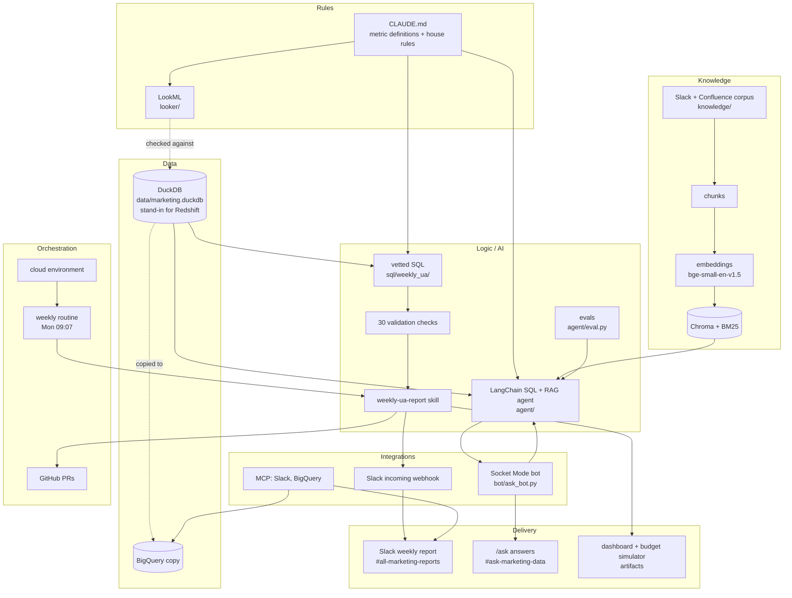

# Marketing Intelligence AI: Dice Kingdom

An AI-powered marketing intelligence system for **Dice Kingdom**, a fictional free-to-play
casual mobile game made by the fictional studio **Pipfall Games**, built as a practice project
for a mobile gaming company. Validated user-acquisition (UA) metrics are delivered
automatically to Slack every week. They can be explored in a dashboard and a budget simulator,
and questions are answered on demand with `/ask` in Slack. Answers combine warehouse data with
the team's Slack and Confluence history. Every number is checked before it is published and
every source is cited.

All data is synthetic: 90 days (2026-06-01 → 2026-08-29), 6 channels (Meta, Google, AppLovin,
Unity, TikTok, Organic), 6 countries (US, UK, DE, JP, BR, FR) and 2 platforms (iOS, Android).

## Architecture



The layers are explained one by one in [docs/ARCHITECTURE.md](docs/ARCHITECTURE.md).

## What's in this repo

| Folder / file | Purpose |
|---|---|
| `data/marketing.duckdb` | The synthetic warehouse: `ua_spend`, `cohorts`, `daily_kpis` |
| `CLAUDE.md` | Single source of truth for table grains, joins, metric SQL and house rules |
| `sql/weekly_ua/` | Vetted, parameterised SQL for the weekly report, its validation checks and the dashboard export |
| `scripts/` | `weekly_ua_report.py` (report + checks), `post_to_slack.py` (webhook poster), `export_dashboard_data.py` (dashboard CSVs), `build_simulator.py` (budget simulator), `generate_data.py` (rebuilds the database) |
| `.claude/skills/weekly-ua-report/` | The skill that runs the weekly report end to end: SQL → checks → review → Slack → exports |
| `artifacts/budget_simulator.html` | Template for the budget simulator page (`DATA` / `PRESET` blocks filled by `build_simulator.py`) |
| `looker/` | LookML project modelling the same tables as if they lived in Redshift, with tests that run the LookML logic against DuckDB |
| `knowledge/` | Synthetic company knowledge base: 44 Slack threads and 20 Confluence pages for the same period |
| `agent/` | LangChain agent (Claude + tools) that answers questions with read-only SQL and hybrid RAG, with citations; plus its eval set |
| `bot/` | Slack `/ask` bot (`slack_bolt`, Socket Mode) that puts the agent in Slack |
| `tests/` | Unit tests for the `/ask` bot |
| `answers/` | Answer key for the planted data anomalies (an exercise; don't open it before analysing the data) |
| `docs/` | Architecture write-up |

## Live outputs

- **UA dashboard:** <https://claude.ai/artifact/7jMwJv2eypzMuVD5h1yUjL>
- **Budget simulator:** <https://claude.ai/artifact/9mDdaTXQgxTzoP8s52gzC4>
- **Slack `#all-marketing-reports`:** the weekly UA report (headline, structural issues, one
  recommended action, week-over-week recap, date windows and check result).
- **Slack `#ask-marketing-data`:** `/ask` questions and the agent's cited answers.
- **Weekly routine:** every Monday at 09:07 a scheduled run executes the `weekly-ua-report`
  skill, posts the report to Slack and refreshes the dashboard and simulator data.

## How to run

```bash
pip install -r requirements.txt                       # core: duckdb, pandas, lkml, ...
pip install -r agent/requirements.txt slack_bolt      # agent + bot only
```

### Weekly report and exports

```bash
python scripts/weekly_ua_report.py [--week YYYY-MM-DD]   # writes reports/weekly_ua_<monday>.{md,slack,json}
python scripts/post_to_slack.py --dry-run reports/weekly_ua_<monday>.slack
python scripts/post_to_slack.py reports/weekly_ua_<monday>.slack   # needs SLACK_WEBHOOK_URL
python scripts/export_dashboard_data.py                  # reports/dashboard/*.csv
python scripts/build_simulator.py                        # reports/budget_simulator.html
```

The report exits `1` and refuses to post if any validation check fails. `reports/` is
git-ignored.

### Analytics agent

```bash
python agent/rag/ingest.py                               # build the Chroma index (agent/rag/index/)
python agent/ask.py "Why did Android D1 retention drop in late July?"   # needs DICE_AGENT_API_KEY
python agent/eval.py                                     # full eval with LLM judge (~$0.35)
python agent/eval.py --no-judge                          # deterministic checks only
```

### Slack `/ask` bot

```bash
python bot/ask_bot.py      # needs SLACK_BOT_TOKEN, SLACK_APP_TOKEN, DICE_AGENT_API_KEY
```

Slack app setup: enable Socket Mode, create an app-level token with `connections:write`, add
the `commands` bot scope, create a `/ask` slash command and install the app. If the RAG index
is missing, the bot builds it on startup. Details in [docs/ARCHITECTURE.md](docs/ARCHITECTURE.md).

### Tests

```bash
python -m pytest tests looker/tests                      # bot + LookML syntax and house rules
python looker/tests/check_sql_logic.py --week 2026-08-10 # LookML SQL vs the vetted report SQL
```

### Rebuilding the data

```bash
python scripts/generate_data.py                          # rewrites data/marketing.duckdb and validates it
```

### Environment variables

Names only. Set them in your shell or the environment's secret settings, never in the repo.

| Variable | Used by |
|---|---|
| `SLACK_WEBHOOK_URL` | `scripts/post_to_slack.py` (weekly report) |
| `DICE_AGENT_API_KEY` | `agent/` and `bot/` (Anthropic API key) |
| `SLACK_BOT_TOKEN` | `bot/ask_bot.py` (bot user OAuth token) |
| `SLACK_APP_TOKEN` | `bot/ask_bot.py` (app-level token for Socket Mode) |

## More

- [docs/ARCHITECTURE.md](docs/ARCHITECTURE.md): layers, metric rules, end-to-end flows, design
  decisions, eval results and limitations.
- [`agent/README.md`](agent/README.md), [`looker/README.md`](looker/README.md),
  [`knowledge/README.md`](knowledge/README.md), [`sql/weekly_ua/README.md`](sql/weekly_ua/README.md):
  component details.
