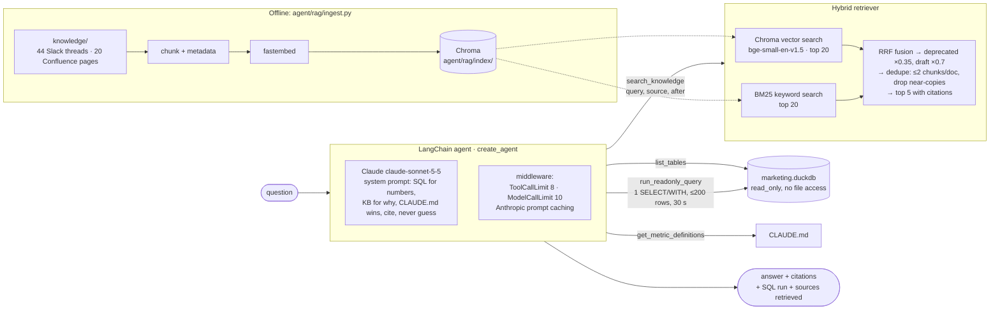

# Dice Kingdom analytics agent (SQL + RAG)

A LangChain agent that answers growth-team questions about Dice Kingdom by combining:

- **SQL** over `data/marketing.duckdb` for every number, and
- **RAG** over `knowledge/` (Slack threads and Confluence pages) for context, explanations and
  decisions.

It runs on Claude (`claude-sonnet-5-5`) through `langchain-anthropic`.

```bash
python agent/ask.py "Why did Android D1 retention drop in late July?"
```

## Architecture



| File | Role |
|---|---|
| `rag/ingest.py` | Loads `knowledge/`, chunks it, embeds with fastembed, writes the Chroma collection. Prints chunk counts. |
| `rag/retriever.py` | Hybrid search: Chroma vectors + BM25, RRF merge, down-ranking, de-duplication. |
| `tools.py` | The four LangChain tools: `search_knowledge`, `list_tables`, `get_metric_definitions`, `run_readonly_query`. Also a trace of every call. |
| `core.py` | System prompt, model, middleware, and `DiceAgent.ask()`, which returns the answer, the SQL run, the sources, token use and cost. |
| `ask.py` | CLI. |
| `eval.py` | Evaluation set and scorer. `eval_results.json` holds the latest run. |
| `config.py` | Paths, model, chunk sizes, retrieval weights, limits. |

## How to run

```bash
pip install -r requirements.txt -r agent/requirements.txt

# 1. Build the index. It goes to agent/rag/index/, is git-ignored, and is rebuilt from scratch.
#    The first run downloads the ~130 MB ONNX embedding model into agent/rag/index/models/.
python agent/rag/ingest.py

# 2. Ask a question. Needs an Anthropic API key in DICE_AGENT_API_KEY.
export DICE_AGENT_API_KEY=...
python agent/ask.py "What did we decide about unity_video_retarget in July, and why?"

# 3. Evaluate. The full run costs about $0.35.
python agent/eval.py                # LLM judge on
python agent/eval.py --only q07 q10 # subset
python agent/eval.py --no-judge     # deterministic checks only
```

`ask.py` prints three sections:

1. **ANSWER**, with inline citations.
2. **SQL RUN**: every query, with its row count or error.
3. **SOURCES RETRIEVED**: each search and its top-5 hits, with citation, score, path, and
   deprecated/draft flags.

A footer gives tool-call count, tokens and estimated cost.

The API key is read from `DICE_AGENT_API_KEY` and passed explicitly to `ChatAnthropic` as a
`SecretStr`. It is never printed or logged. If the variable is missing, the error names the
variable, not a value.

## Design choices

### Chunking

- **Slack is chunked by thread.** A thread is the unit of meaning: question, wrong guesses,
  correction, decision. Splitting it would separate a claim from its correction, so each thread
  is one chunk. A thread over ~500 tokens would be split on message boundaries with a
  one-message overlap. None is that long today; the longest is ~440 tokens. Many threads are
  shorter than the 300-token floor, and they are deliberately not merged with other threads.
- **Confluence is chunked by heading.** Pages are split on Markdown headings (code fences are
  ignored). Consecutive sections are merged up to ~400 tokens (hard cap 500). An oversized
  section is split on paragraphs, then lines, so tables stay whole where possible. Each chunk
  carries ~50 tokens of overlap from the previous chunk.
- **Every chunk starts with a context header.** For Slack: channel, thread title, date, author.
  For Confluence: page title, space, status, last-updated date, `superseded_by`, section path.
  Embeddings and BM25 both see it, and the LLM always sees a `[DEPRECATED - do not use]` or
  `[DRAFT]` tag even on a chunk that doesn't contain the page banner.
- **Metadata** per chunk: `source`, `channel` / `space`, `title`, `author`, `date` (thread
  start or `last_updated`), `date_end` (last reply), `status`, `deprecated`, `draft`, `path`,
  `doc_id`, `citation`.
- **Result:** 64 documents become 69 chunks (44 Slack, 25 Confluence). Sizes run 112–461
  tokens, median ~220. Token counts are approximated as characters / 4.
- `knowledge/README.md` and `slack/users.json` are not indexed. They describe the corpus and
  its people; the *Team Directory* page covers the people.

### Hybrid search

- **Two retrievers.**
  - Vector search (Chroma, cosine, `BAAI/bge-small-en-v1.5` via fastembed, 384 dims, CPU-only)
    catches paraphrases such as "why did installs get cheaper" → "click spam".
  - BM25 catches exact identifiers that embeddings blur: `unity_video_retarget`, `2.14.0`,
    `UNT-VID-03`. Its tokenizer keeps snake_case ids whole and also indexes their parts.
- **Merging.** Each retriever returns its top 20 candidates. They are merged with Reciprocal
  Rank Fusion (k = 60), which needs no score calibration between BM25 and cosine.
- **Filters.** `source` takes `slack`, `confluence`, a `#channel` or a Confluence space.
  `after` takes `YYYY-MM-DD` and keeps documents with activity on or after that date. Both are
  applied identically to both retrievers.
- **De-duplication.**
  - At most 2 chunks per document, so one long page can't fill the top 5.
  - A chunk whose body has more than 80% token-set (Jaccard) overlap with an already-selected
    chunk is dropped. This removes near-copies such as *Copy of Creative Testing Process*.
- **Output.** The top 5 come back with their citation strings, `[Slack #channel YYYY-MM-DD]`
  or `[Confluence: title]`. The thread start date is used for Slack.

### Deprecated, draft and stale documents

- **Deprecated pages are kept but down-ranked.** A page counts as deprecated if its status is
  `deprecated`, it has a `superseded_by` key, or its body starts with a DEPRECATED banner. Its
  fused score is multiplied by 0.35; drafts are multiplied by 0.7. The page can still be found
  when someone asks about it directly ("what did the old v1 definition say?"), but it loses to
  the current page on normal queries.
- **The tool output flags them too.** Results show `!! DEPRECATED PAGE: do not use it for
  definitions or numbers`.
- **The system prompt sets precedence.** CLAUDE.md beats any document. Deprecated pages are
  never used for definitions. Current/final pages win over drafts and older pages. Later Slack
  corrections win over earlier guesses.
- **Eval q10 tests this.** It explicitly asks for "the D7 ROAS definition from our wiki" on a
  window that includes an immature day. The deprecated v1 formula gives ~17.1%; the correct
  v3/CLAUDE.md formula gives ~20.3%.
- **Known gap.** *Weekly UA Report Template (2025)* says `status: current` with no
  `superseded_by`, so metadata alone can't flag it. The model has to notice the 2025 date.

### SQL safety

- **The connection is locked down.** DuckDB opens with `read_only=True` and
  `enable_external_access=False`, so `read_csv('…')`, `COPY … TO`, `ATTACH` and extension
  installs all fail.
- **Queries are validated before they run.** DuckDB's own parser (`duckdb.extract_statements`)
  must return exactly one statement of type SELECT, and its first keyword must be `SELECT` or
  `WITH`. This rejects `PRAGMA`, which parses as SELECT.
- **Results and runtime are capped.** Results stop at 200 rows (the model is told to aggregate
  further). A 30-second timer calls `interrupt()` on runaway queries.
- **Metric definitions come from CLAUDE.md.** `get_metric_definitions` returns everything from
  *Dataset at a glance* to the end: grains, joins, exact SQL, house rules. The model is told to
  read it before writing metric SQL.

### Cost and latency limits

- **Tool calls.** At most 8 per question, enforced by `ToolCallLimitMiddleware(run_limit=8,
  exit_behavior="continue")`. Over-budget calls are blocked with an error message, so the model
  has to answer with what it has. `ModelCallLimitMiddleware(run_limit=10)` is a backstop on
  model round-trips. The prompt also tells the model to batch metrics into one query and to run
  independent calls in parallel.
- **Prompt caching.** `AnthropicPromptCachingMiddleware` caches tools, system prompt and the
  growing conversation between round-trips within a question.
- **Model settings.** `effort: medium` is a good level for multistep tool use, and
  `max_tokens` is 4096. Sampling parameters are left at their defaults, since
  `claude-sonnet-5-5` rejects non-default `temperature`.
- **Small payloads.** Tool results are capped at 5 chunks of ≤500 tokens or 200 rows, which
  keeps every round-trip small.
- **Observed cost.** The eval averages ~3 tool calls and $0.02–0.03 per question. Embedding and
  retrieval are local and free.

## Evaluation

`agent/eval.py` has 11 questions about the three Q3 incidents:

- the **Unity click spam** on `unity_video_retarget` (from 2026-07-09)
- the **Android retention drop** after app release 2.14.0 (cohorts from 2026-07-22)
- the **Google Android attribution outage** (2026-08-06 → 08-09)

| Type | Questions | What it tests |
|---|---|---|
| Pure SQL | q01–q03 | Numbers computed with CLAUDE.md definitions: CPI/CTR before and after, daily installs/CPI, D1 by platform |
| Pure knowledge | q04–q06 | Decisions and root cause: Unity decision, post-mortem, September plan |
| Why (both) | q07–q09 | Data plus the explanation from documents |
| Deprecated trap | q10 | Must use v3/CLAUDE.md D7 ROAS (~20.3%), not the deprecated v1 page (~17.1%) |
| Refusal | q11 | D30 ROAS for Aug cohorts is not mature yet, so the agent must decline instead of estimating |

Metrics:

- **Answer correctness.** An LLM judge (`claude-sonnet-5-5`, effort low) compares each answer
  with a hand-written reference answer and rubric. Deterministic key-fact regexes (numbers,
  key terms) and must-not patterns are reported alongside.
- **Retrieval hit rate.** For questions with an expected document: does at least one expected
  document appear in the top 5 of the agent's searches? It is also measured retriever-only,
  with the raw question as the query.
- **Citation presence.** Knowledge and why answers must contain at least one well-formed
  citation.
- **Citation validity.** Every citation in the answer must match a source that was actually
  retrieved, which catches invented or mangled citations.

### Latest results

Final run (`agent/eval_results.json`):

```
q01 [sql   ] PASS  facts 4/4   retrieval=None  cite=None  tools=3
q02 [sql   ] PASS  facts 8/8   retrieval=None  cite=None  tools=4
q03 [sql   ] PASS  facts 4/4   retrieval=None  cite=None  tools=2
q04 [kb    ] PASS  facts 3/3   retrieval=True  cite=True  tools=2
q05 [kb    ] PASS  facts 2/2   retrieval=True  cite=True  tools=4
q06 [kb    ] PASS  facts 3/3   retrieval=True  cite=True  tools=1
q07 [both  ] PASS  facts 3/3   retrieval=True  cite=True  tools=5
q08 [both  ] PASS  facts 3/3   retrieval=True  cite=True  tools=4
q09 [both  ] PASS  facts 3/3   retrieval=True  cite=True  tools=3
q10 [both  ] PASS  facts 2/2   retrieval=True  cite=True  tools=3
q11 [refuse] PASS  facts 1/1   retrieval=None  cite=None  tools=2

Answer correctness (LLM judge):  11/11 = 100%
Key-fact regex checks:           11/11 = 100%
Retrieval hit rate (top 5):      7/7 = 100%   (retriever-only, raw question: 7/7)
Citation presence (kb + why):    7/7 = 100%
Citation validity:               9/9 = 100%
Deprecated D7 ROAS page relied on: no (q10)
Tool calls: avg 3.0, max 5 (cap 8) · agent cost $0.20 total, ~$0.02/question
```

How it got here. These runs used the same questions:

1. **First run:** 11/11 correct, but citation validity was 8/9. On q08 the model wrote
   `[Slack #ua-team 2025-08-25]` (wrong year), and cited a reply date (07-16) instead of the
   thread's start date (07-14).
2. **Fix:** the system prompt now says to copy citations verbatim and always use the thread's
   start-date citation.
3. **Second run:** citation validity 9/9. One key-fact regex was too strict for "8.2–9.3k/day"
   (the judge passed that answer), so the regex was widened.
4. **Final run:** shown above.

Caveats:

- 11 questions is a smoke test, not a benchmark. Answers vary between runs.
- The judge shares the agent's model family.
- The three incidents are well covered by the corpus, which makes retrieval easy. Harder
  multi-hop or adversarial questions would be the next thing to add.
