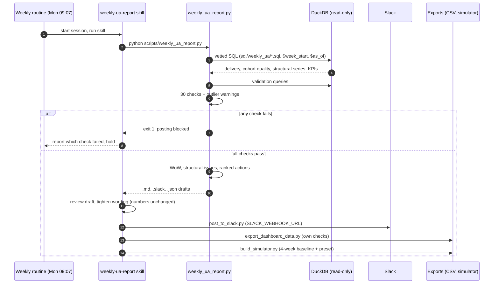
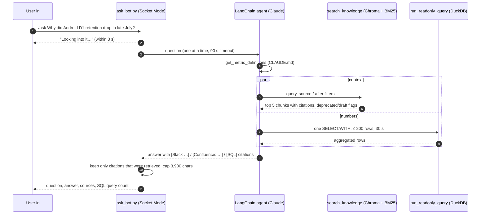

# Architecture

How the Dice Kingdom marketing intelligence system fits together, layer by layer, and why it
is built this way. Dice Kingdom and its studio, Pipfall Games, are fictional, and all data is
synthetic (2026-06-01 → 2026-08-29, as-of date 2026-08-29).

## Layers

### Data

**What it does.** `data/marketing.duckdb` holds three tables:

| Table | Grain | Contents |
|---|---|---|
| `ua_spend` | date × channel × campaign × country × platform × creative | spend, impressions, clicks, attributed installs |
| `cohorts` | install_date × channel × campaign × country × platform | installs, D1/D7/D30 retained, cumulative revenue D0/D7/D30, D7 payers |
| `daily_kpis` | date × platform | DAU, revenue, payers (game-wide, no channel) |

A copy of the same tables is loaded into BigQuery and queried through the BigQuery MCP
server.

**Why.** DuckDB is a single-file, zero-setup stand-in for a Redshift warehouse, so the whole
system runs in a laptop or a cloud session. The BigQuery copy proves the SQL and definitions
carry over to a second warehouse and give the same numbers.

### Rules

**What it does.** `CLAUDE.md` is the one place where grains, join rules, exact metric SQL
(CPI, CTR, IPM, ROAS, retention, ARPDAU, payer conversion) and house rules are written down.
The `looker/` LookML project encodes the same definitions as Looker measures, and its tests
check that the LookML logic produces the same numbers as the vetted SQL.

**Why.** A metric has to mean the same thing in the report, the dashboard, the agent and
Looker. Writing the rules once, and testing every consumer against them, stops definitions
drifting apart.

### Knowledge

**What it does.** `knowledge/` is a synthetic company knowledge base: 44 Slack threads (four
channels) and 20 Confluence pages, deliberately messy (drafts, near-copies, a deprecated
definition page, wrong guesses corrected later in a thread). `agent/rag/ingest.py` turns it
into 69 chunks (one per Slack thread; Confluence split by heading, ~400 tokens), each with a
context header and metadata. Chunks are embedded locally with `BAAI/bge-small-en-v1.5`
(fastembed) and stored in Chroma. A BM25 index over the same chunks is built at query time.

**Why.** Numbers explain *what* happened; the team's Slack and wiki explain *why* and *what
was decided*. Chunking by thread keeps a claim next to its correction, and the metadata lets
retrieval prefer current pages over deprecated or draft ones.

### Logic / AI

**What it does.**

- **Vetted SQL** (`sql/weekly_ua/`): parameterised queries for delivery, cohort quality,
  structural trends, game KPIs and the dashboard export.
- **30 validation checks** run by `scripts/weekly_ua_report.py` before anything is published:
  `ua_spend` → cohort-grain reconciliation (FULL JOIN, so orphans count), paid spend
  surviving the cohort join, breakdown rows summing to totals, delivery vs cohort totals,
  no unexpected NULLs, no values on immature cohorts, no impossible values, no missing days,
  and structural-series tie-outs. Robust z-score outliers are reported as warnings.
- **`weekly-ua-report` skill** (`.claude/skills/weekly-ua-report/SKILL.md`): the procedure
  Claude follows each week: run the script, read the checks, review the draft, post, export
  the dashboard CSVs, rebuild the budget simulator.
- **LangChain SQL + RAG agent** (`agent/`): Claude (`claude-sonnet-5-5`) with four tools:
  `run_readonly_query`, `list_tables`, `get_metric_definitions` (returns CLAUDE.md) and
  `search_knowledge` (hybrid retriever).
- **Evals** (`agent/eval.py`): 11 questions with hand-written reference answers, scored by
  key-fact regexes, an LLM judge, retrieval hit rate and citation validity.

**Why.** The numbers come from deterministic scripts and the AI writes the words around them.
The checks decide whether a report may be published, not the model.

### Integrations

**What it does.**

- **MCP servers** for Slack and BigQuery let Claude read and post in Slack and query the
  BigQuery copy directly from a session.
- **Slack incoming webhook**: `scripts/post_to_slack.py` posts the weekly report. The URL is
  read from `SLACK_WEBHOOK_URL`, must start with `https://hooks.slack.com/`, and is redacted
  from every error message.
- **Socket Mode bot**: `bot/ask_bot.py` (`slack_bolt`) receives `/ask` over a WebSocket, so it
  needs no public URL.

**Why.** Each integration does one job with the smallest credential that does it: a webhook
can only post to one channel, and Socket Mode avoids exposing an HTTP endpoint.

### Orchestration

**What it does.** A weekly routine runs every Monday at 09:07 in a Claude Code cloud
environment and executes the `weekly-ua-report` skill. Code changes go through GitHub pull
requests on `main`.

**Why.** The report should arrive without anyone running it, and every change to SQL, checks
or prompts is reviewed before it affects what stakeholders see.

### Delivery

**What it does.**

- **Slack weekly report** in `#all-marketing-reports`: one headline, up to 3 structural
  issues, 1 recommended action ranked by dollar impact, a WoW recap line, and a footer with
  the date windows and the check result.
- **`/ask` answers** in `#ask-marketing-data`: question, answer with inline citations, and a
  short source list including the number of SQL queries run.
- **Dashboard** and **budget simulator** artifacts, built from the exported weekly CSVs. The
  simulator starts from the last 4 complete weeks and can apply the week's recommended action
  as a preset.

## The three metric rules

1. **Mature cohorts only, in numerator and denominator.** D7/D30 values are NULL until a
   cohort is old enough (as of 2026-08-29: D1 ≤ 08-28, D7 ≤ 08-22, D30 ≤ 07-30). Filtering
   only the numerator (`SUM(d7_retained) / SUM(installs)`) keeps young cohorts' installs, or
   spend, in the denominator and understates retention and ROAS. Every Dn ratio filters both
   sides on the metric column being `IS NOT NULL`. NULL is never treated as 0.
2. **Sum spend to cohort grain before joining.** `ua_spend` has one row per creative (3 per
   campaign); `cohorts` has none. Joining directly repeats each cohort row 3 times. Spend is
   first summed over `date × channel × campaign × country × platform`, which matches
   `cohorts` row for row (11,880 rows, 4,485,121 installs on both sides).
3. **Organic is excluded from paid metrics.** Organic has installs but no spend, impressions
   or clicks; left in, it lowers CPI and dilutes CTR, IPM and ROAS. CPI, CTR, IPM and ROAS
   always use `channel <> 'Organic'`. Retention may include Organic, labelled as such.

## End-to-end flows

### Weekly report

### An `/ask` question

At most 8 tool calls per question. On a failure or timeout the bot posts a short apology
naming only the error type. For a step-by-step conceptual explanation (what is precomputed,
what happens live, how embeddings and hybrid search work), see
[HOW_ASK_WORKS.md](HOW_ASK_WORKS.md).

## Design decisions

| Decision | Why |
|---|---|
| Numbers from scripts, words from AI | Every figure in the report comes from vetted SQL run by a script, and every figure in an agent answer from a SQL tool call. The model writes the narrative, never the numbers, so a hallucinated figure has no path into the output. |
| Validation gates before publishing | The report refuses to post if any of the 30 checks fails, and the dashboard export and simulator build refuse to write. A wrong number reaching an exec costs more than a late report. |
| One metric definition everywhere | CLAUDE.md is the source of truth. The vetted SQL, LookML, the agent (via `get_metric_definitions`) and the BigQuery queries all follow it, and tests compare LookML with the vetted SQL. |
| Read-only access, row caps and tool-call limits | The agent's DuckDB connection is `read_only` with external access disabled; queries must parse as one SELECT/WITH; results stop at 200 rows and 30 s; at most 8 tool calls and 10 model calls per question. This bounds damage, cost and latency. |
| Hybrid search | Vector search catches paraphrases ("why did installs get cheaper" → click spam); BM25 catches exact ids such as `unity_video_retarget` or `2.14.0`. Reciprocal Rank Fusion merges them without score calibration. |
| Down-rank rather than delete deprecated docs | Deprecated pages are multiplied by 0.35 and drafts by 0.7, and flagged in tool output. They can still answer "what did the old definition say?", but lose to the current page on normal queries. Deleting them would hide history the team still refers to. |
| Evals with known answers | 11 questions with reference answers and rubrics, including a deprecated-definition trap and a must-refuse question, so changes to prompts or retrieval are measured, not guessed. |

## Consistency check

The same metric, computed by every consumer, gives the same answer.

**Meta D7 ROAS, installs 2026-08-10 → 2026-08-16** (all D7-mature, paid only):

| Where | Value |
|---|---|
| Weekly report (`weekly_ua_report.py --week 2026-08-10`) | 19.1% |
| Slack answer | 19.1% |
| LookML check (`looker/tests/check_sql_logic.py --week 2026-08-10`) | 19.12% |
| BigQuery copy | 19.1% |
| Agent (`agent/ask.py`) | 19.1% |
| `/ask` bot | 19.1% |

## Eval results

From the agent's last run (`agent/eval_results.json`), 11 questions about three Q3 incidents
(Unity click spam, the Android 2.14.0 retention drop, the Google Android attribution outage):

| Metric | Result |
|---|---|
| Answer correctness (LLM judge) | 11/11 |
| Key-fact regex checks | 11/11 |
| Retrieval hit rate (top 5) | 7/7 |
| Citation presence (knowledge + why questions) | 7/7 |
| Citation validity | 9/9 |
| Deprecated D7 ROAS page relied on (q10) | no |
| Tool calls per question | avg 3.0, max 5 (cap 8) |
| Latency per question | avg ~10 s |

**Cost per question:** about $0.02 (agent total $0.20 for 11 questions, at `claude-sonnet-5-5`
list prices with prompt caching). A full eval run including the LLM judge costs about $0.35.
Embedding and retrieval run locally and cost nothing.

## How this maps to a production stack

| Here | In production |
|---|---|
| DuckDB file | Redshift (the LookML already targets schema `marketing` on a Redshift connection) |
| LookML project, tested against DuckDB | Looker, serving the same explores and dashboard |
| `/ask` bot in Socket Mode, run from a session | A managed Slack integration, always on |
| Weekly routine on a fixed Monday time | Triggered when the data pipeline (e.g. Airflow) finishes loading the week |

## Limitations and next steps

- **Synthetic data.** The dataset and knowledge base are generated, with planted anomalies.
  Real data would be noisier and need more checks.
- **Looker not run live.** The LookML is parsed, checked against house rules and rendered to
  SQL that runs on DuckDB, but it has not been deployed to a Looker instance.
- **The eval is a smoke test.** 11 questions on well-covered incidents, judged by a model of
  the same family. Harder multi-hop and adversarial questions are the next step.
- **The bot is single-threaded and only runs while a session is active.** Questions run one
  at a time because the agent's tool trace is process-wide, and the bot stops when its
  session ends.
- **Secrets should move to a secrets manager.** Today they are environment variables (names
  only in this repo). Production should load them from a secrets manager with rotation.
