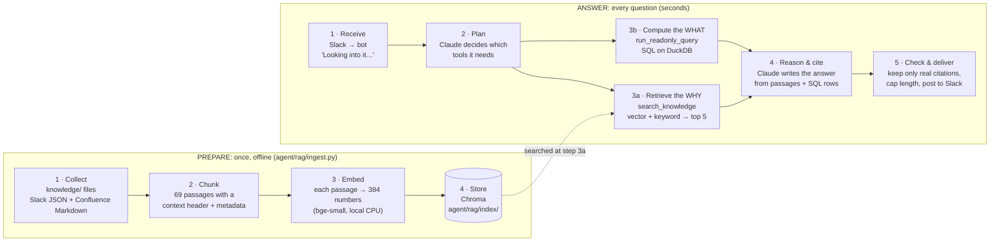

# How `/ask` works: a conceptual framework

What happens between typing `/ask <question>` in Slack and reading a cited answer. This page
explains the ideas; [ARCHITECTURE.md](ARCHITECTURE.md) has the system-wide view and
[`agent/README.md`](../agent/README.md) has the implementation details.

## The framework in one picture

The system works in two phases. **Prepare** runs once, before anyone asks anything.
**Answer** runs for every question, in six steps.

The idea to remember: **the original files are never read when a question arrives.** The
bot searches the prepared index (step 4 of Prepare), and Claude reads only the handful of
passages the search returns.

## Phase 1: Prepare (offline, once)

Think of a library. The files are the books, and Prepare is a librarian who writes an index
card for every passage of every book.

| Step | What happens | Why it matters |
|---|---|---|
| **1 · Collect** | Read the 64 source documents in `knowledge/`: 44 Slack threads (`.json`) and 20 Confluence pages (Markdown with a YAML header holding title, space, owner, `last_updated` and `status`). | The knowledge base is a snapshot. In this project the files are synthetic; in a company they'd be exported from the Slack and Confluence APIs. |
| **2 · Chunk** | Cut documents into passages: **one Slack thread = one chunk**, Confluence pages split by heading (~400 tokens, ~50 overlap). Each chunk starts with a context header (source, title, date, status) and carries metadata (channel/space, dates, `deprecated`, `draft`, citation string). | Small passages keep answers fast and cheap. Keeping a thread whole means a claim stays next to its correction. The metadata powers the filters, the down-ranking and the citations. |
| **3 · Embed** | Turn each chunk into a vector of 384 numbers with `BAAI/bge-small-en-v1.5`, running locally on the CPU (free). | The vector is a "meaning fingerprint": passages about the same topic get similar vectors even when they use different words. |
| **4 · Store** | Save text + metadata + vector for all 69 chunks in **Chroma**, an embedded vector database, in `agent/rag/index/`. | This is what gets searched at question time. The folder is **git-ignored** and rebuilt from `knowledge/` by `python agent/rag/ingest.py`; the bot builds it on startup if it's missing. |

**Consequence:** editing a file in `knowledge/` changes nothing until Prepare runs again.

## Phase 2: Answer (every question)

Worked example: *"What caused the Android retention drop in late July? Check the release log
and what the team said in Slack, and confirm the impact on D1 retention with data."*

### 1 · Receive (`bot/ask_bot.py`)

Slack delivers the slash command to the bot over **Socket Mode** (a WebSocket the bot opens,
so no public URL is needed). The bot replies *"Looking into it…"* within Slack's 3-second
window, then hands the question to a background worker. Questions run one at a time, with a
90-second limit.

### 2 · Plan (`agent/core.py`)

Claude receives the question together with a system prompt that sets the rules: numbers come
only from SQL, `CLAUDE.md` beats any document, deprecated pages are never used for
definitions, later corrections beat earlier guesses, cite every claim, never guess. Claude
picks from four tools, with a budget of **at most 8 tool calls**:

| Tool | Gives Claude | Used for |
|---|---|---|
| `get_metric_definitions` | The metric rules from `CLAUDE.md` | How to compute D1 retention correctly |
| `search_knowledge` | Top 5 passages from the knowledge base | The *why*: release log, Slack discussion, decisions |
| `run_readonly_query` | Rows from DuckDB | The *what*: the actual D1 numbers |
| `list_tables` | Table names, columns, date ranges | Orientation, when needed |

### 3a · Retrieve the WHY (`agent/rag/retriever.py`)

Claude writes a short search phrase, e.g. *"Android 2.14.0 release retention drop"*. Then:

1. **Embed the query** with the same model → one 384-number vector (milliseconds).
2. **Vector search**: Chroma returns the 20 chunks whose vectors are closest (cosine). This
   finds passages with the same *meaning* ("cheaper installs" ↔ "click spam").
3. **Keyword search**: BM25 returns the 20 chunks that best match the *exact words*. This
   finds identifiers that embeddings blur (`2.14.0`, `unity_video_retarget`).
4. **Fuse** the two lists by rank (Reciprocal Rank Fusion). Chunks high on both lists win.
5. **Down-rank** deprecated pages (×0.35) and drafts (×0.7).
6. **De-duplicate**: at most 2 chunks per document, and near-copies are dropped.
7. **Return the top 5** as plain text, each with its citation, e.g.
   `[Confluence: Android Release Log — 2026]`.

Claude never sees vectors, only the 5 passages. It may search again with a different phrase
(e.g. for the leadership decision) and get another 5.

### 3b · Compute the WHAT (`agent/tools.py`)

Claude writes SQL following `CLAUDE.md` (here: D1 retention on D1-mature cohorts only,
split by platform and Paid/Organic, before and after 2026-07-22). Each query must be a single
`SELECT`/`WITH`, and runs on a **read-only** connection with no file access, a 200-row cap and
a 30-second timeout.

### 4 · Reason & cite

Claude combines the passages and the SQL rows into an answer: direct answer first, then
evidence bullets. Every claim carries a citation (`[Slack #ua-team 2026-07-28]`,
`[Confluence: …]`, `[SQL]`). Disagreements are stated, e.g. "the team said ~6 points, the
data shows 7.6". Quoted figures are labelled, and anything that can't be checked is said
plainly instead of estimated.

### 5 · Check & deliver

The bot converts Markdown to Slack formatting. It builds the **Sources** list only from
citations that appear in the answer **and** were actually retrieved (so an invented citation
can't appear), adds the SQL query count, caps the message at 3,900 characters and posts it in
the channel. It logs one line: question, duration, estimated cost, status. On an error or
timeout it posts a short apology naming only the error type.

## What is precomputed vs live

| | When | Cost / time |
|---|---|---|
| Reading, chunking, embedding the 64 documents | Prepare (offline) | Seconds; free (local) |
| Embedding the search phrase | Per search | Milliseconds; free (local) |
| Vector + keyword search, fusion | Per search | Milliseconds; free (local) |
| SQL queries | Per question | Milliseconds to seconds; free (local DuckDB) |
| Claude reasoning (several round-trips) | Per question | Most of the ~10–15 s; about $0.02–0.03 |

## Guardrails at each step

| Step | Guardrail | Protects against |
|---|---|---|
| Prepare | Context header and `deprecated`/`draft` flags on every chunk | Outdated pages being mistaken for current ones |
| Plan | System prompt rules; at most 8 tool calls and 10 model calls | Made-up numbers, runaway cost |
| Retrieve | Down-ranking, de-duplication, top 5 only | Stale or duplicate pages crowding out the right one |
| Compute | Read-only connection, one SELECT, 200 rows, 30 s | Writes, file access, huge or slow queries |
| Reason | Cite every claim; say when sources conflict; refuse when data isn't mature | Unsupported or overconfident answers |
| Deliver | Sources list = cited ∩ retrieved; errors show the type only | Invented citations, leaked secrets or stack traces |

## Glossary

| Term | Meaning here |
|---|---|
| **Chunk** | A passage of a document (one Slack thread, or a few Confluence sections) that is stored and retrieved as a unit. |
| **Embedding** | A list of 384 numbers that represents a chunk's meaning; similar meanings give similar vectors. |
| **Vector database (Chroma)** | Stores chunks with their embeddings and quickly finds the ones nearest to a query vector. |
| **BM25** | Classic keyword ranking: scores chunks by how well they match the query's exact words. |
| **Hybrid search** | Vector search and keyword search run together and merged. |
| **RRF (Reciprocal Rank Fusion)** | Merges ranked lists by position (`1 / (60 + rank)`), so the two scoring scales never need comparing. |
| **RAG** | Retrieval-Augmented Generation: retrieve relevant passages, then have the model answer from them. |
| **Tool call** | Claude asking the program to run a function (search, SQL) and return the result. |

## FAQ

**Is Chroma in the repository?** The code that builds and searches it is
(`agent/rag/ingest.py`, `agent/rag/retriever.py`, `chromadb` in `agent/requirements.txt`).
The index itself (`agent/rag/index/`) is git-ignored and rebuilt from `knowledge/`.

**If I add a Slack thread to `knowledge/`, will `/ask` find it?** Only after re-running
`python agent/rag/ingest.py` (or restarting the bot without an index).

**Does Claude read whole documents?** No. It reads the top-5 passages from each search,
up to ~500 tokens each.

**Are the numbers embedded too?** No. Embeddings are only for text. Numbers come from SQL
on the database, which is how a warehouse handles very large tables.

**Would this scale to a real company?** The search does: vector databases use approximate
nearest-neighbour indexes (Chroma uses HNSW), so millions of chunks still take milliseconds.
At scale the index would usually live in shared infrastructure (e.g. OpenSearch for built-in
hybrid search, pgvector, or BigQuery vector search). The harder problems are per-user
permissions, incremental updates instead of full rebuilds, and keeping stale documents out of
the top results.
